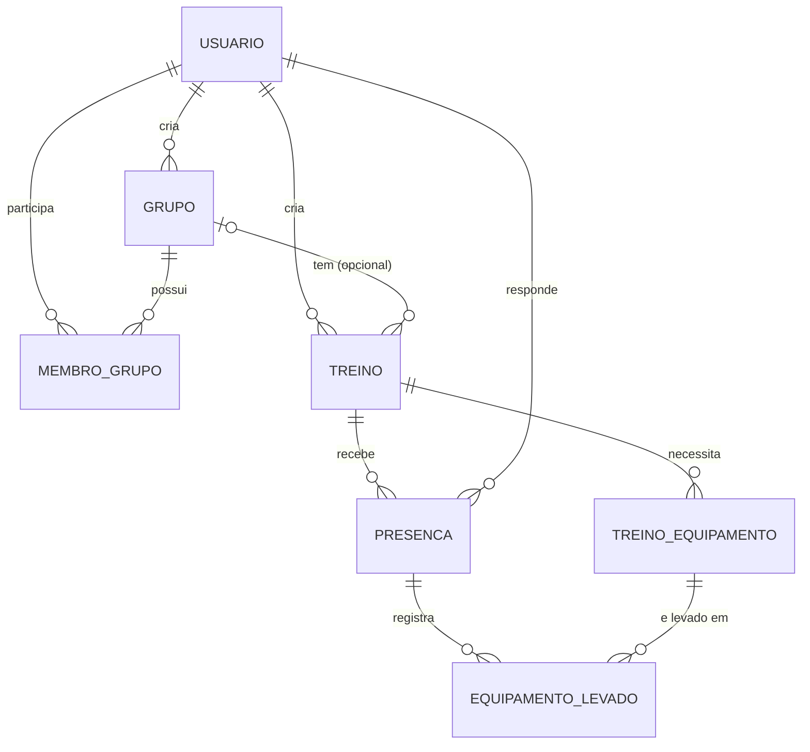

# Jogo Certo — Especificação do Protótipo (versão revisada)

## 1. Objetivo

O Jogo Certo é uma aplicação web para facilitar a organização de treinos e partidas esportivas. A plataforma permite criar grupos, organizar treinos, convidar participantes por código ou link, confirmar presença e combinar quem levará cada equipamento necessário.

O objetivo é substituir a organização confusa feita apenas por mensagens em grupos de conversa.

### 1.1 Fora do escopo (não será feito neste protótipo)

Chat, notificações (e-mail, push ou WhatsApp), calendário integrado, recuperação de senha, verificação de e-mail, login social (Google etc.), treinos recorrentes, lista de espera, upload de imagens, aplicativo nativo, exclusão de treinos (o treino só pode ser cancelado) e convite por e-mail (o convite é sempre por código ou link).

## 2. Usuários e permissões

Todos os usuários precisam ter uma conta para utilizar o sistema.

- **Aluno e Professor:** são apenas um dado do cadastro. Têm exatamente as mesmas permissões.
- **Membro do grupo:** usuário que entrou em um grupo.
- **Administrador do grupo:** membro que criou o grupo ou foi nomeado administrador por outro administrador.
- **Criador do treino:** usuário que cadastrou o treino.

### 2.1 Quem pode fazer o quê

| Ação | Quem pode |
|---|---|
| Criar grupo | Qualquer usuário logado (passa a ser criador e administrador) |
| Entrar em um grupo com código | Qualquer usuário logado |
| Ver o grupo, seus membros e seus treinos | Membros do grupo |
| Editar o grupo (nome, modalidade, descrição) | Administradores |
| Remover membro | Administradores (o criador do grupo não pode ser removido) |
| Nomear outro administrador | Administradores |
| Excluir o grupo | Somente o criador do grupo |
| Criar treino independente | Qualquer usuário logado |
| Criar treino vinculado a um grupo | Membros do grupo |
| Editar, cancelar e publicar o resultado de um treino | Somente o criador do treino |
| Responder presença e informar equipamentos | Quem tem acesso ao treino (regra RN04), com o treino ativo e ainda não realizado |

## 3. Regras de negócio

- **RN01 — Convite:** convidar significa compartilhar um código ou link. Não há envio de e-mail.
- **RN02 — Código de convite:** gerado no servidor, aleatório, com no mínimo 8 caracteres alfanuméricos e único. Nunca é sequencial nem previsível.
- **RN03 — Administração:** o criador do grupo é administrador automaticamente. Todo grupo tem sempre pelo menos um administrador.
- **RN04 — Acesso ao treino:**
  - Treino vinculado a grupo: criador e membros do grupo.
  - Treino independente: o criador e qualquer usuário logado que abra o link ou use o código de convite do treino. Ao responder presença, o treino passa a aparecer em "Meus treinos" dessa pessoa.
- **RN05 — Presença:** cada usuário tem no máximo uma resposta por treino ("Vou" ou "Não vou"). Pode alterá-la até o horário do treino, enquanto ele estiver ativo. Ao mudar para "Não vou", os equipamentos que a pessoa tinha se comprometido a levar são removidos.
- **RN06 — Equipamentos:** o criador define a lista de equipamentos necessários do treino (nome e quantidade). Quem respondeu "Vou" escolhe, dessa lista, o que e quanto levará. O sistema mostra, para cada item, a quantidade necessária e a quantidade já assumida.
- **RN07 — Visibilidade do resultado (RF12):** conforme a tabela abaixo. A publicação é feita pelo criador e não pode ser desfeita. Depois de publicada, as informações continuam atualizadas se alguém alterar sua resposta.
- **RN08 — Mínimo de participantes (RF13):** conta apenas respostas "Vou". O aviso é calculado quando o criador abre a página do treino; não existe processo automático. O criador decide: não faz nada (mantém) ou cancela.
- **RN09 — Cancelamento:** é irreversível. O status "cancelado" é visível para todos que têm acesso ao treino, mesmo que o resultado não tenha sido publicado. Depois de cancelado, ninguém responde presença e o criador não edita.
- **RN10 — Edição:** o criador pode editar os dados do treino enquanto ele estiver ativo. As respostas já registradas são mantidas.
- **RN11 — Treino já realizado:** se a data e o horário já passaram, o treino não aceita novas respostas nem edições. O status continua "ativo" (a situação é calculada pela data).
- **RN12 — Exclusão de grupo:** remove o grupo, seus membros e seus treinos, após confirmação. Treinos independentes não são afetados.
- **RN13 — Fuso horário:** data e horário são guardados sem fuso (tipos DATE e TIME) e interpretados sempre como horário de Manaus (America/Manaus). Toda comparação "já passou?" deve usar esse fuso, porque o servidor da hospedagem funciona em UTC.

### 3.1 Tabela de visibilidade (RN07)

| Informação | Criador do treino | Demais participantes, antes da publicação | Demais participantes, depois da publicação |
|---|---|---|---|
| Dados do treino e lista de equipamentos necessários | Vê | Vê | Vê |
| Status "cancelado" | Vê | Vê | Vê |
| Sua própria resposta e seus próprios equipamentos | Vê | Vê | Vê |
| Quantidade de confirmados e nomes de quem confirmou | Vê sempre | Não vê | Vê |
| Quem leva cada equipamento | Vê sempre | Não vê | Vê |
| Quem respondeu "Não vou" | Vê sempre | Não vê | Não vê |
| Aviso de mínimo não atingido | Vê | Não vê | Não vê |

## 4. Requisitos funcionais

- **RF01:** O sistema deve permitir cadastro com nome completo, e-mail (único), senha (mínimo de 8 caracteres) e tipo de usuário (aluno ou professor).
- **RF02:** O sistema deve permitir login e logout. Páginas internas exigem usuário autenticado.
- **RF03:** O usuário deve poder criar grupos. Administradores editam o grupo e o criador pode excluí-lo.
- **RF04:** O sistema deve gerar, para cada grupo e para cada treino independente, um código e um link de convite.
- **RF05:** O administrador deve poder remover participantes e nomear outros administradores. Qualquer usuário logado entra no grupo usando o código ou link.
- **RF06:** O usuário deve poder criar treinos independentes ou vinculados a grupos dos quais seja membro.
- **RF07:** O treino deve possuir título, modalidade esportiva, local, data, horário, quantidade mínima de participantes (inteiro maior ou igual a 1), lista de equipamentos necessários (opcional) e observações (opcional).
- **RF08:** O criador do treino deve poder editar ou cancelar o evento.
- **RF09:** O participante deve poder confirmar presença com as opções "Vou" e "Não vou" e alterar a resposta (RN05).
- **RF10:** Quem confirmar "Vou" deve poder informar quais equipamentos da lista levará e em que quantidade.
- **RF11:** O sistema deve apresentar os dados do treino e a quantidade de participantes, respeitando a tabela de visibilidade (seção 3.1).
- **RF12:** O criador visualiza todas as respostas a qualquer momento e decide quando publicar o resultado. Os demais participantes só visualizam o resultado após a publicação.
- **RF13:** Se a quantidade mínima de participantes não for atingida, o sistema deve exibir um aviso ao criador. O criador decide se mantém ou cancela o treino.
- **RF14:** Quando um treino for cancelado, os participantes devem visualizar o status "cancelado".
- **RF15:** O sistema deve listar "Meus grupos" e "Meus treinos" (treinos que criei, treinos dos meus grupos e treinos em que respondi), ordenados por data.

## 5. Requisitos não funcionais

- **Segurança:** senhas armazenadas somente com hash, nunca em texto puro. A biblioteca de autenticação cuida do hash e da sessão.
- **Validação:** todos os formulários são validados no servidor (a validação no navegador é apenas conforto para o usuário).
- **Autorização:** toda ação e toda consulta verificam no servidor se o usuário logado tem permissão (ser membro, administrador, criador ou ter acesso por convite). Esconder um botão na tela não conta como proteção.
- **Banco de dados:** informações persistidas em PostgreSQL, nunca apenas no navegador.
- **Proteção contra SQL Injection:** consultas feitas por meio do ORM ou com parâmetros, nunca concatenando texto do usuário.
- **Credenciais:** senhas, chaves e strings de conexão ficam em variáveis de ambiente. O arquivo `.env` fica no `.gitignore` e o repositório contém um `.env.example` sem valores reais.
- **Login:** mensagem de erro genérica ("e-mail ou senha incorretos"), sem revelar se o e-mail existe.
- **Interface:** funciona em computadores e celulares, simples, moderna e esportiva.

## 6. Telas do protótipo

1. Cadastro.
2. Login.
3. Painel inicial: Meus treinos e Meus grupos, com botões para criar treino e criar grupo.
4. Criar e editar grupo.
5. Página do grupo: dados, código/link de convite, lista de membros, treinos do grupo. Administradores veem as ações de remover e nomear.
6. Entrar em grupo por código ou link.
7. Criar e editar treino (inclui a lista de equipamentos necessários).
8. Página do treino: dados, status, minha resposta, equipamentos, resultado. O criador vê ainda o aviso de mínimo, as respostas completas e as ações editar, publicar resultado e cancelar.
9. Abrir treino independente por código ou link de convite (leva à página do treino; se o usuário não estiver logado, vai ao login e volta ao convite).

## 7. Modelo de dados (DER)

### 7.1 Tabelas

- **usuario:** id, nome, email (único), tipo_usuario ('aluno' ou 'professor'), criado_em.
  - A biblioteca de autenticação gerencia esta tabela e cria outras próprias (sessões e contas). Nesse modelo, o hash da senha costuma ficar na tabela de contas e não em `usuario`. Isso deve ser mostrado no DER final.
  - O tipo do `id` de `usuario` define o tipo de todas as chaves estrangeiras que apontam para ele (a biblioteca costuma usar texto). Tipos diferentes causam erro de chave estrangeira.
- **grupo:** id, nome, modalidade, descricao, codigo_convite (único), criador_id → usuario, criado_em.
- **membro_grupo:** id, grupo_id → grupo, usuario_id → usuario, permissao ('admin' ou 'membro'), entrou_em. Restrição: único (grupo_id, usuario_id).
- **treino:** id, titulo, modalidade, local, data (DATE), horario (TIME), minimo_participantes (inteiro ≥ 1), observacoes, criador_id → usuario, grupo_id → grupo (pode ser nulo = treino independente), codigo_convite (único), status ('ativo' ou 'cancelado'), resultado_publicado (booleano, padrão falso), criado_em, atualizado_em.
- **treino_equipamento:** id, treino_id → treino, nome, quantidade_necessaria (inteiro ≥ 1). Lista do que o treino precisa, definida pelo criador.
- **presenca:** id, treino_id → treino, usuario_id → usuario, resposta ('vou' ou 'nao_vou'), respondido_em. Restrição: único (treino_id, usuario_id).
- **equipamento_levado:** id, presenca_id → presenca, treino_equipamento_id → treino_equipamento, quantidade (inteiro ≥ 1). Restrição: único (presenca_id, treino_equipamento_id). Só existe para presenças "vou" (regra aplicada no servidor).

### 7.2 Relacionamentos e exclusão em cascata

- Um usuário cria vários grupos e vários treinos.
- Um grupo tem vários membros e vários treinos. Um usuário participa de vários grupos (relação N:N por `membro_grupo`).
- Um treino pode ser independente (grupo_id nulo).
- Um treino tem várias presenças, uma por usuário.
- Um treino tem vários itens de equipamento necessário. Cada presença "vou" pode registrar vários equipamentos levados.
- Excluir um grupo exclui seus membros e treinos. Excluir um treino (via grupo) exclui suas presenças e equipamentos. Excluir uma presença exclui seus equipamentos levados.

## 8. Critérios de aceite

| ID | Dado que | Quando | Então |
|---|---|---|---|
| CA01 | o usuário não possui conta | faz o cadastro com dados válidos | a conta é criada no banco e a senha aparece apenas como hash |
| CA02 | já existe conta com o e-mail | alguém tenta cadastrar o mesmo e-mail | o sistema recusa e não cria duplicata |
| CA03 | os dados do cadastro são inválidos (e-mail inválido, senha com menos de 8 caracteres) | o formulário é enviado | o servidor recusa e nada é gravado |
| CA04 | o usuário possui conta | faz login com dados corretos | acessa o painel |
| CA05 | o usuário possui conta | faz login com senha incorreta | recebe mensagem genérica e não acessa |
| CA06 | o usuário não está logado | tenta abrir uma página interna | é levado ao login |
| CA07 | o usuário está logado | faz logout | a sessão termina e as páginas internas voltam a exigir login |
| CA08 | o usuário está logado | cria um grupo | o grupo é salvo, o criador é administrador, um código é gerado e o grupo aparece em "Meus grupos" |
| CA09 | um grupo existe | outro usuário entra com o código | ele aparece como membro; com código inexistente, recebe erro |
| CA10 | um usuário é administrador | remove um membro e nomeia outro administrador | as alterações são salvas; um membro comum não consegue fazer o mesmo, nem por requisição direta |
| CA11 | um usuário não é membro do grupo | tenta abrir o grupo ou treino do grupo | o acesso é negado |
| CA12 | o usuário está logado | cria um treino independente | o treino é salvo no banco, recebe código de convite e aparece em "Meus treinos" |
| CA13 | o usuário é membro de um grupo | cria um treino vinculado ao grupo | os membros do grupo veem o treino |
| CA14 | um treino foi criado por outra pessoa | um usuário não criador tenta editar, cancelar ou publicar | a ação é negada |
| CA15 | um treino está ativo e disponível | o participante confirma "Vou" e depois muda para "Não vou" | a resposta é registrada e atualizada, sem duplicar |
| CA16 | o participante respondeu "Vou" | informa um equipamento da lista | a contribuição aparece para ele; ao mudar para "Não vou", ela é removida |
| CA17 | o resultado não foi publicado | um participante abre o treino | ele vê só os dados do treino e a própria resposta; o criador vê todas as respostas |
| CA18 | o criador publicou o resultado | os participantes abrem o treino | veem a quantidade, os nomes de quem confirmou e quem leva cada equipamento |
| CA19 | o treino tem menos confirmações que o mínimo | o criador abre o treino | vê um aviso; o aviso some ao atingir o mínimo e nunca aparece para os demais |
| CA20 | o criador cancelou o treino | os participantes abrem o treino | veem "cancelado" e não conseguem responder; o criador não consegue editar |
| CA21 | a data e o horário do treino já passaram | alguém tenta responder presença | o sistema recusa |
| CA22 | o usuário cria um treino | envia título vazio, mínimo 0 ou data inválida | o servidor recusa e nada é gravado |
| CA23 | dados foram cadastrados | o site é aberto novamente depois de um novo deploy | os dados continuam lá (persistência no banco) |

## 9. Segurança — lista de verificação

- Senha com hash e nunca em log ou resposta de API.
- Nenhum segredo no código ou no GitHub; `.env` ignorado e `.env.example` presente.
- Verificação de permissão no servidor em todas as ações e consultas (criador, administrador, membro, acesso por convite).
- Validação de todas as entradas no servidor.
- Consultas com parâmetros (ORM).
- Códigos de convite aleatórios e não sequenciais.
- Sessão por cookie gerenciado pela biblioteca de autenticação, com site publicado em HTTPS (Vercel).
- Mensagens de erro de login genéricas.

## 10. Testes

- **Manuais (obrigatórios):** executar cada critério de aceite (CA01 a CA23) e registrar em uma tabela: ID, data, resultado (passou ou falhou), observação.
- **Automáticos (mínimo de 5 testes, com Vitest):** as regras de negócio ficam em funções simples e separadas (por exemplo, um arquivo `regras`), sem depender de banco ou tela, e são testadas:
  - aviso de mínimo (abaixo, igual e acima do mínimo);
  - quem pode ver o resultado (criador, participante antes da publicação, participante depois);
  - quem pode editar ou cancelar o treino;
  - se o treino já passou (usando o fuso de Manaus);
  - validação dos formulários (casos válidos e inválidos).

## 11. Documentação a entregar

- `README.md`: descrição do projeto, tecnologias, como rodar localmente, variáveis de ambiente e link do site publicado.
- Este documento (requisitos, regras e critérios de aceite) e o DER.
- Relatório de testes (tabela da seção 10).
- Registro de uso de IA: ferramentas usadas (ChatGPT, Claude, Codex), decisões tomadas e principais pedidos feitos.
- Capturas de tela das principais telas.

## 12. Stack e deploy

- **Frontend e backend:** Next.js (App Router) com TypeScript. A versão 16 renomeou `middleware.ts` para `proxy.ts`; tutoriais antigos podem não funcionar. Fixar as versões no `package.json` e consultar a documentação atual.
- **Estilização:** Tailwind CSS.
- **Banco de dados:** PostgreSQL no Neon (plano gratuito). Usar a conexão "pooled" na aplicação e a conexão direta nas migrações, confirmando na documentação do Neon.
- **Acesso ao banco:** Drizzle ORM, com migrações versionadas no repositório.
- **Autenticação:** Better Auth, somente com e-mail e senha.
- **Validação:** Zod.
- **Testes:** Vitest.
- **Versionamento:** Git e GitHub.
- **Publicação:** Vercel (plano Hobby, uso pessoal e escolar, sem fins comerciais).
- **Ambientes:** um banco para desenvolvimento e outro para o site publicado (por exemplo, duas branches no Neon). Variáveis configuradas no painel da Vercel.

## 13. Plano de desenvolvimento por etapas

Cada etapa termina com testes manuais da etapa, commit no GitHub e deploy.

1. **Etapa 0:** repositório, projeto Next.js, página simples publicada na Vercel e conexão com o Neon funcionando.
2. **Etapa 1:** cadastro, login e logout; proteção das páginas internas (CA01 a CA07).
3. **Etapa 2:** grupos, convite e administração (CA08 a CA11).
4. **Etapa 3:** treinos independentes e de grupo, edição e listagens (CA12 a CA14, CA22).
5. **Etapa 4:** presença e equipamentos (CA15, CA16, CA21).
6. **Etapa 5:** visibilidade, publicação, aviso de mínimo e cancelamento (CA17 a CA20).
7. **Etapa 6:** testes automáticos, ajustes de interface, README e documentação final (CA23).

### Regras para o Codex (arquivo `AGENTS.md` na raiz do repositório)

- Ler este documento antes de qualquer alteração e trabalhar uma etapa por vez.
- Não criar funcionalidades fora deste documento.
- Verificar permissões no servidor em toda ação.
- Nunca colocar segredos no código.
- Manter o código simples e comentado, para que o autor consiga explicá-lo.
- Rodar lint e testes antes de encerrar cada etapa.

## 14. Limitações conhecidas do protótipo

- Não há recuperação de senha nem verificação de e-mail.
- Um membro removido pode voltar usando o código do grupo, pois não há troca de código.
- Não há notificações; os participantes precisam abrir o site para ver mudanças.
- O resultado publicado não pode ser desfeito.
- O banco gratuito pode demorar alguns segundos na primeira requisição após um período sem uso.
